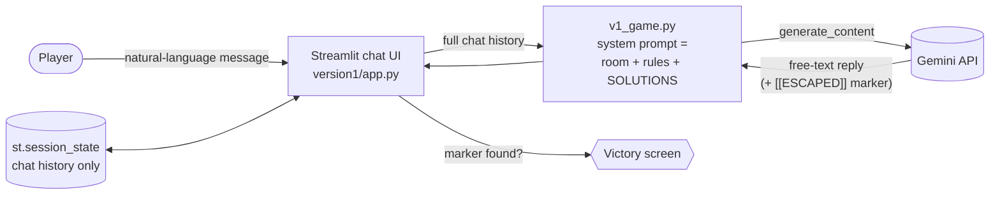
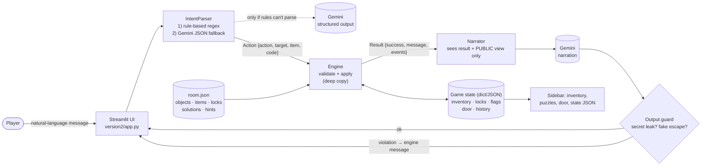

# Architecture

## Version 1 — LLM as the whole game

* The **only** memory is the chat transcript.
* The LLM decides what exists, whether actions succeed, and when the player has escaped.
* The puzzle solutions sit in the same prompt the player is talking to.

## Version 2 — Python decides, the LLM describes

### Responsibilities

| Component | File | Decides | Never does |
|---|---|---|---|
| Room config | `version2/room.json` | Objects, items, locks, codes, hints | — |
| Intent parser | `version2/intent_parser.py` | *What the player is trying to do* | Change the state |
| Engine | `version2/engine.py` | *Whether it works* and the new state | Call the LLM |
| Narrator | `version2/narrator.py` | *How it sounds* | See codes/solutions, change the state |
| Guard | `narrator.guard()` | Whether narration is safe to show | — |
| UI | `version2/app.py` | Display, restart, debug toggle | Game logic |

### Trust boundaries
1. **Player text → Parser.** Untrusted. Meta/injection phrases become a `meta` action. LLM parser output is validated against a Pydantic schema and a fixed vocabulary.
2. **Action → Engine.** Even a perfectly valid-looking Action is checked against the rules (inventory, locks, puzzle prerequisites). Work happens on a deep copy.
3. **Engine → Narrator.** The narrator gets `public_view(state)`: no codes, no solutions. It cannot leak what it was never told.
4. **Narrator → Player.** The guard replaces any narration that contains an unrevealed secret or claims an escape the engine did not grant.

### Offline mode
Without `GEMINI_API_KEY` (or with `ESCAPE_ROOM_OFFLINE=1`) Version 2 still works: the rule-based parser handles input and the engine's own message is shown. This is what the automated tests use.
